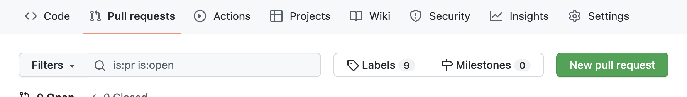
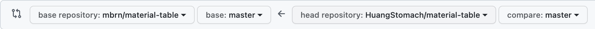
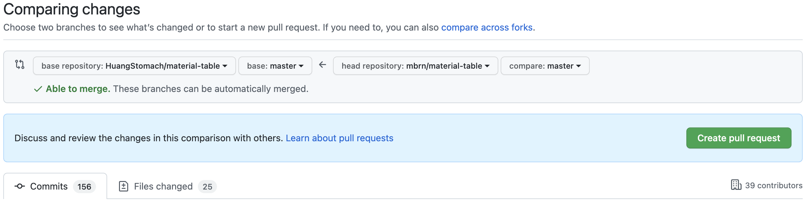

> github的一些简单妙用

## Pull request

Pull request在参与开源项目的时候是一个非常常用的功能，可以在提交代码时不影响到当前分支，并由项目所有团队进行审核讨论，依据结果考虑是否合并。

为开源项目贡献代码操作很简单，fork想要贡献的项目，然后在本地clone自己的项目，修改后提交到自己的项目，就可以在git上提交pr(pull request)了。

但是经常会遇到的一个问题，当提交完pr之后，源项目仍然会有其他的开发者贡献代码，当自己再想要提交pr的时候会发现本地的clone项目和源项目已经不一致了，这时候就需要同步源项目的代码到自己的项目了。

不过这个功能很难在github上直接找到，不过可以先观察第一次创建pr时候的方法。以开源项目[mbrn/material-table](https://github.com/mbrn/material-table)为例，当我们点击clone项目的`New pull request`按钮时：



会跳转到提交新pr的页面，可以看到url形如：

```
https://github.com/mbrn/material-table/compare/master...HuangStomach:material-table:master
```

的url，对应界面则可以看到：



直观的理解就是将本地clone项目的提交，形成pr提交到源项目。

同理，为了实现同步源项目的代码到clone项目，我们只需要将url的内容进行调换，url形如：

```
https://github.com/HuangStomach/material-table/compare/master...mbrn:material-table:master
```

将这个url输入到浏览器，可以看到：



我们就将源项目的代码提交同步到了自己的clone项目，这样就可以再次提交pr了。

## Diff

diff这个功能很常用，在本地查阅自己的本地修改都涉及到哪些文件的哪些内容时经常会用到，往往出现在git的commit信息中。

但有时候有这样的需求，希望观察某个提交head到某个提交head之间文件都做了哪些更改，可以考虑使用`git diff`命令：

``` bash
usage: git diff [<options>] [<commit>] [--] [<path>...]
   or: git diff [<options>] --cached [--merge-base] [<commit>] [--] [<path>...]
   or: git diff [<options>] [--merge-base] <commit> [<commit>...] <commit> [--] [<path>...]
   or: git diff [<options>] <commit>...<commit> [--] [<path>...]
   or: git diff [<options>] <blob> <blob>
   or: git diff [<options>] --no-index [--] <path> <path>
```

不过这种diff显示的输出被称为`source diff`，不是很直观。尤其在想整体显示具体更改了哪些内容时，这种diff显示就不太友好了。而这种需要，称之为`rich diff`。

`rich diff`由于其局限性难以在命令行中显示，此时可以考虑使用`git diff --word-diff`来通过[wdiff](https://www.endpointdev.com/blog/2022/01/wdiff-alternative-git-diff-word-diff/)进行展示。

不过对应上文的url大法，我们也可以在github上更加直观的查看`rich diff`，考虑url形如：

```
https://github.com/HuangStomach/{rep}/compare/{commit_id}...{commit_id}
```

则会在web页面直接输出该repository下两commit之间的不同，还可以更加优雅的直接显示`rich diff`：


