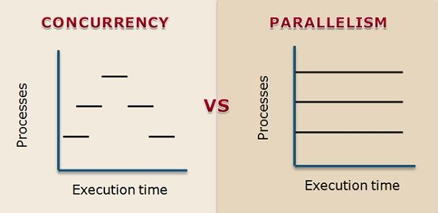

> 有的时候总是能听到许多新的名词，并且背后的解释还容易令人混淆。有的时候重复造轮子，有的时候换汤不换药。

## 并发和并行

并发的概念经常可以听到，也总会和并行放到一起讨论，但是实际上并发和并行是两个不同的概念。简单来说并发可以认为是早期单核CPU做完成的工作，让多个程序来一段时间内来回切换让大家认为计算机在同时执行多个程序。而并行则是多核CPU的概念，可以真正的同时执行多个程序。

### 并发

处理多个待定任务，一次处理一个或者一部分，然后转而处理另一个任务，再转而处理另一个任务，如此循环。对于单核的CPU，如果操作系统的调度程序支持交叉执行待定任务，也能实现并发。并发也叫多任务处理。

### 并行

同时执行多个计算任务的能力。需要一个多核CPU、多个CPU、一个GPU或一个集群中的多台计算机。

并行是真正意义上的同时做，类似于团队协作，多个人聚在一起分工合作完成一个任务。当然一个任务也可以由一个人来完成，但这些任务在一个人的手中永远是不停切换来做的，而不是真正意义上的同时做，这就是并发。

并发和并行在开发中离不开执行单元的支持，比如进程、线程、协程等。

## 执行单元

### 进程

进程是计算机程序运行时的一个实例，消耗内存和部分的CPU时间。进程与进程之间相互隔离，都隔离在自己的私有内存空间中，进程之间的通信需要通过进程间通信（IPC）的方式。进程可以派生子进程，子进程可以继承父进程的资源，但是子进程的内存空间是独立的。操作系统的调度程序会定期挂起运行中的进程，让其他进程运行，这样挂起单个进程不会导致整个系统的挂起。

### 线程

单个进程中的执行单元。一个进程启动后只使用一个主线程，但是可以创建多个子线程。线程之间共享进程的资源，比如内存空间，但是每个线程都有自己的寄存器和栈空间。线程之间的通信可以通过共享内存或者消息传递的方式。线程之间的切换不会导致整个进程的挂起，但是线程之间的切换需要操作系统的调度程序来完成。线程在同一份作业下，消耗的资源比进程少。

### 协程

可以挂起自身并在以后恢复的函数。协程可以在执行过程中挂起，然后转而执行其他协程，这个过程可以重复多次。协程支持协作式多任务处理：一个协程必须使用`yield`或`await`或其他挂起点显式地放弃控制权，以便其他协程可以执行。协程可以在单线程中实现并发，因为它们是协作式的，而不是抢占式的。

以前对协程的非常不理解，总觉得一定要属于更细粒度的线程以及具备更多的并发操作空间。实际上不然，协程主要是通过程序来控制并保存当前状态，切换代价较小，具备线程所不具备的效率。

例如在网络请求中，数据需要经过网络以及其他的IO缓冲区，此时可以应用协程发出请求后立即转移CPU所有权，等待数据返回后再将CPU所有权转移回协程，这样就可以在等待数据的时候不阻塞主线程，提高了程序的执行效率。

或者遍历发送多个网络请求，在使用协程时，每个协程在发送请求后不会阻塞，控制权会交还给事件循环，于是可以同时发送多个请求而不用排队等待。最后可以遍历协程的实例来按照完成顺序获得结果。

再或者在构建Web服务的时候，定义接收请求的函数为协程，当遇到IO阻塞操作时将其交由协程操作（或特殊情况交由其他线程），可以不阻塞主线程，使其可以转而处理其他请求，实现了在单线程中处理多请求的效果。

协程的实现方式有很多，比如Python中的`asyncio`，Go中的`goroutine`，Java中的`Quasar`等。其中Javascript中的`generator`和`async/await`是比较常用的。`async/await`也是生成器和`Promise`的语法糖，整体使用上比较简单，各种语言具体使用也极为相似。

至于纤程的概念，[此文](https://softwareengineering.stackexchange.com/questions/254140/is-there-a-difference-between-fibers-coroutines-and-green-threads-and-if-that-i)中有详细的讨论，大部分场景下没有区别。
